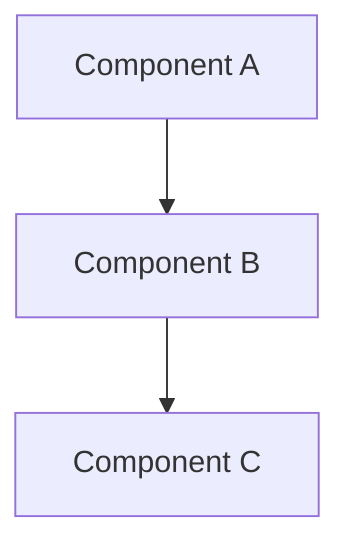

# KeefeOS Contribution Guide

## Welcome to KeefeOS Development! 🚀

KeefeOS is building the world's most advanced AI-powered operating system. We welcome contributors from all backgrounds and skill levels. This guide will help you get started contributing to specific areas of the project.

---

## Table of Contents

1. [Getting Started](#getting-started)
2. [For Rust Kernel Developers](#for-rust-kernel-developers)
3. [For ML Engineers](#for-ml-engineers)
4. [For Security Researchers](#for-security-researchers)
5. [For Technical Writers](#for-technical-writers)
6. [For UI/UX Designers](#for-uiux-designers)
7. [Code Standards](#code-standards)
8. [Submission Process](#submission-process)

---

## Getting Started

### Prerequisites

```bash
# Install Rust nightly
curl --proto '=https' --tlsv1.2 -sSf https://sh.rustup.rs | sh
rustup default nightly
rustup component add rust-src llvm-tools clippy rustfmt

# Clone the repository
git clone https://github.com/keefeos/keefeos.git
cd KeefeOS

# Install QEMU for testing
# Ubuntu/Debian
sudo apt install qemu-system-x86 qemu-system-x86_64 ovmf

# Verify setup
cargo build -p keefeos-kernel --target x86_64-unknown-none
```

### Project Structure Overview

```
KeefeOS/
├── kernel/              # Core kernel code
│   ├── ai/             # AI/ML subsystem
│   ├── security/       # Security features
│   ├── llm_agent/      # LLM integration
│   ├── arch/           # Architecture-specific code
│   ├── memory/         # Memory management
│   └── interrupts/     # Interrupt handling
├── bootloader/         # UEFI bootloader
├── xtask/             # Build automation
└── docs/              # Documentation
```

---

## For Rust Kernel Developers 🦀

### What We Need

We're looking for Rust experts to help build our microkernel from the ground up. Key areas include:

#### Priority Tasks

1. **Multitasking System** (Phase 6)
   - Timer interrupt implementation (PIT/APIC)
   - Thread control blocks and context switching
   - ML-enhanced round-robin scheduler
   - Priority-based scheduling algorithms

2. **User-Space Infrastructure** (Phase 7)
   - Ring 3 transition and protection
   - Inter-process communication (IPC)
   - Zero-copy shared memory
   - Asynchronous message queues

3. **Driver Framework** (Phase 8)
   - Isolated driver architecture
   - Keyboard/mouse drivers
   - Network stack (TCP/IP)
   - Virtual filesystem (VFS)

4. **Memory Management Enhancements**
   - Advanced page fault handling
   - Copy-on-write optimization
   - Memory-mapped files
   - Swap space management

### Skills Required

- **Expertise Level**: Intermediate to Advanced Rust
- **Key Concepts**:
  - Unsafe Rust and FFI
  - Embedded systems programming
  - x86_64 architecture
  - Operating system concepts
  - Concurrency and synchronization

### Getting Started with Kernel Development

```bash
# Build and test the kernel
cargo build -p keefeos-kernel --target x86_64-unknown-none

# Run in QEMU
cargo xtask run

# Run kernel tests
cargo test -p keefeos-kernel --target x86_64-unknown-none

# Check code quality
cargo clippy -p keefeos-kernel --target x86_64-unknown-none
cargo fmt -p keefeos-kernel -- --check
```

### Example: Adding a New Exception Handler

```rust
// kernel/src/interrupts/idt.rs

// 1. Define the handler function
#[no_mangle]
extern "C" fn alignment_check_handler(stack_frame: &mut InterruptStackFrame) -> ! {
    panic!(
        "Alignment Check Error at IP={:#x}",
        stack_frame.instruction_pointer
    );
}

// 2. Add to IDT initialization
pub fn init() {
    unsafe {
        IDT.load();
        IDT.alignment_check
            .set_handler_fn(alignment_check_handler);
    }
}
```

### Resources

- [Writing an OS in Rust](https://os.phil-opp.com/)
- [Rust Embedded Book](https://docs.rust-embedded.org/book/)
- [Intel® 64 and IA-32 Architectures Software Developer's Manual](https://www.intel.com/content/www/us/en/developer/articles/technical/intel-sdm.html)
- [AMD64 Architecture Programmer's Manual](https://www.amd.com/system/files/TechDocs/24594.pdf)

---

## For ML Engineers 🤖

### What We Need

Help us improve our kernel-level AI/ML subsystem to make KeefeOS truly intelligent.

#### Priority Tasks

1. **Neural Network Engine Optimization**
   - Improve inference performance
   - Add support for more network architectures
   - Implement model quantization for reduced memory
   - Add training capabilities for on-device learning

2. **ML-Based Scheduler Enhancement**
   - Collect and analyze scheduling data
   - Train models on real workload patterns
   - Implement reinforcement learning for dynamic optimization
   - A/B testing framework for model comparison

3. **Memory Prediction Improvements**
   - Page access pattern analysis
   - Prefetching algorithm optimization
   - Workload classification
   - Adaptive prediction strategies

4. **Anomaly Detection System**
   - Behavioral analysis improvements
   - Zero-day attack detection
   - False positive reduction
   - Real-time threat scoring

5. **Model Persistence**
   - Save/load trained models across reboots
   - Model versioning and rollback
   - Incremental learning support
   - Model compression for storage efficiency

### Skills Required

- **Expertise Level**: Intermediate to Advanced ML/DL
- **Key Concepts**:
  - Neural networks (feedforward, CNN, RNN)
  - Reinforcement learning
  - Feature engineering
  - Model optimization (quantization, pruning)
  - Time-series analysis
  - Anomaly detection algorithms

### Getting Started with ML Development

```bash
# The AI subsystem is in pure Rust for kernel compatibility
# Key files to review:
# - kernel/src/ai/neural_net.rs
# - kernel/src/ai/scheduler.rs
# - kernel/src/ai/memory_predictor.rs
# - kernel/src/ai/anomaly_detector.rs

# Test AI components (in userspace simulator)
cargo test -p keefeos-kernel --lib ai::

# Analyze performance metrics
cargo xtask benchmark-ai
```

### Example: Improving the Neural Network

```rust
// kernel/src/ai/neural_net.rs

// Current: 4-layer feedforward network
// Potential improvements:

// 1. Add activation function options
pub enum ActivationFunction {
    ReLU,
    Sigmoid,
    Tanh,
    LeakyReLU(f32),
    Swish,
}

// 2. Implement batch normalization
pub struct BatchNormLayer {
    gamma: [[f32; HIDDEN_SIZE]; HIDDEN_SIZE],
    beta: [[f32; HIDDEN_SIZE]; HIDDEN_SIZE],
    running_mean: [f32; HIDDEN_SIZE],
    running_var: [f32; HIDDEN_SIZE],
}

// 3. Add dropout for regularization
pub fn apply_dropout(layer: &mut [f32; HIDDEN_SIZE], rate: f32) {
    for neuron in layer.iter_mut() {
        if random() < rate {
            *neuron = 0.0;
        } else {
            *neuron /= 1.0 - rate;
        }
    }
}
```

### Data Collection & Training

We need help setting up:

1. **Data Collection Framework**
   - System metrics logging
   - Workload characterization
   - Performance counters integration

2. **Training Pipeline**
   - Offline training on collected data
   - Model validation and testing
   - Performance benchmarking

3. **Evaluation Metrics**
   - Scheduler latency improvement
   - Page fault reduction percentage
   - Anomaly detection accuracy
   - Inference time overhead

### Resources

- [TensorFlow](https://www.tensorflow.org/)
- [PyTorch](https://pytorch.org/)
- [ONNX Runtime](https://onnxruntime.ai/)
- [Machine Learning Engineering by Andriy Burkov](https://www.mlebook.com/)

---

## For Security Researchers 🔐

### What We Need

Help us build the most secure operating system ever created through vulnerability analysis and security enhancements.

#### Priority Tasks

1. **Vulnerability Analysis**
   - Code audit for memory safety issues
   - Race condition detection
   - Side-channel vulnerability assessment
   - Formal verification of critical components

2. **Security Feature Development**
   - Capability-based access control refinement
   - Blockchain audit log optimization
   - Encryption performance improvements
   - Secure boot chain enhancement

3. **Attack Detection Improvements**
   - Signature database expansion
   - Behavioral analysis refinement
   - Machine learning model training for threat detection
   - Automated response strategies

4. **Penetration Testing**
   - Kernel fuzzing
   - Privilege escalation attempts
   - DoS resistance testing
   - Hardware attack simulation

5. **Compliance & Certification**
   - Common Criteria preparation
   - Security policy documentation
   - Threat modeling
   - Risk assessment

### Skills Required

- **Expertise Level**: Advanced Security Research
- **Key Concepts**:
  - Operating system security
  - Cryptography (AES, ChaCha20, SHA-256)
  - Vulnerability assessment
  - Exploit development
  - Formal methods
  - Reverse engineering

### Getting Started with Security Research

```bash
# Review security subsystem
# - kernel/src/security/capability.rs
# - kernel/src/security/encryption.rs
# - kernel/src/security/blockchain.rs
# - kernel/src/security/vulnerability_scanner.rs
# - kernel/src/security/attack_detector.rs

# Run security scans
cargo xtask security-audit

# Fuzzing setup
cargo install cargo-fuzz
cargo fuzz build -p keefeos-kernel
```

### Example: Capability System Enhancement

```rust
// kernel/src/security/capability.rs

// Current implementation uses simple tokens
// Potential improvements:

// 1. Add hierarchical capabilities
pub struct HierarchicalCapability {
    parent: Option<CapabilityId>,
    permissions: PermissionSet,
    path_constraints: PathPattern,
    time_constraints: TimeWindow,
}

// 2. Implement capability derivation
impl Capability {
    pub fn derive(&self, restricted_perms: Permissions) -> Result<Self, SecurityError> {
        // Ensure derived capability has subset of original permissions
        if !restricted_perms.is_subset(&self.permissions) {
            return Err(SecurityError::InvalidDerivation);
        }
        
        Ok(Capability {
            id: generate_new_id(),
            resource: self.resource.clone(),
            permissions: restricted_perms,
            issuer: self.id,
            expiry: self.expiry.min(SystemTime::now() + MAX_DERIVATION_DURATION),
        })
    }
}

// 3. Add revocation list
pub struct CapabilityRevocationList {
    revoked_ids: HashSet<CapabilityId>,
    last_updated: SystemTime,
}
```

### Security Testing Tools

We recommend using:

1. **Static Analysis**
   - `cargo clippy` with security lints
   - Miri for undefined behavior detection
   - Custom AST analysis tools

2. **Dynamic Analysis**
   - AFL++ for fuzzing
   - AddressSanitizer (ASan)
   - ThreadSanitizer (TSan)
   - MemorySanitizer (MSan)

3. **Formal Verification**
   - Prusti for Rust verification
   - Kani for bounded model checking
   - Coq/Isabelle for critical proofs

### Resources

- [OWASP Top Ten](https://owasp.org/www-project-top-ten/)
- [Common Weakness Enumeration (CWE)](https://cwe.mitre.org/)
- [NIST Cybersecurity Framework](https://www.nist.gov/cyberframework)
- [The TAO of Hardware Hacking](https://taohacking.com/)

---

## For Technical Writers 📚

### What We Need

Help us create clear, comprehensive, and accessible documentation for developers and users.

#### Priority Tasks

1. **API Documentation**
   - Document all public kernel APIs
   - Create usage examples
   - Write migration guides
   - Maintain changelog

2. **Architecture Documentation**
   - System design overviews
   - Component interaction diagrams
   - Decision records (ADRs)
   - Performance characteristics

3. **User Guides**
   - Installation instructions
   - Configuration tutorials
   - Troubleshooting guides
   - FAQ creation

4. **Developer Onboarding**
   - Quick start guides
   - Contribution guidelines
   - Code style guides
   - Testing procedures

5. **Blog Posts & Announcements**
   - Release notes
   - Feature highlights
   - Community spotlights
   - Technical deep-dives

### Skills Required

- **Expertise Level**: Any level (beginners welcome!)
- **Key Concepts**:
  - Technical writing best practices
  - Markdown proficiency
  - Diagram creation (Mermaid, Draw.io)
  - Version control (Git)
  - Basic understanding of operating systems (helpful but not required)

### Getting Started with Documentation

```bash
# Documentation is in the docs/ directory
# Key files to review and expand:
# - README.md (main project overview)
# - docs/STEP3_IDT.md (example technical doc)
# - CONTRIBUTING.md (this file)

# Build documentation site (future)
cargo xtask build-docs

# Check documentation links
cargo xtask check-docs
```

### Documentation Template

```markdown
# Feature Name

## Overview
Brief description of what this feature does.

## Motivation
Why was this feature created? What problem does it solve?

## Design
Technical details of the implementation.

### Architecture


## Usage
How to use this feature with examples.

```rust
// Example code
let result = keefeos_feature::do_something();
```

## Configuration
Available configuration options.

| Option | Type | Default | Description |
|--------|------|---------|-------------|
| `enabled` | bool | `true` | Enable/disable feature |

## Performance
Performance characteristics and benchmarks.

## Security Considerations
Security implications and mitigations.

## Related Documentation
Links to related features and guides.
```

### Tools We Use

- **Markdown** - Primary documentation format
- **Mermaid** - Diagrams and flowcharts
- **Docusaurus/VitePress** - Documentation site (future)
- **GitHub Wiki** - Community knowledge base

### Resources

- [Documentation Best Practices](https://documentation.divio.com/)
- [Write the Docs Community](https://www.writethedocs.org/)
- [Technical Writing for Developers](https://developers.google.com/tech-writing)

---

## For UI/UX Designers 🎨

### What We Need

Help us design the future graphical interface for KeefeOS. While currently command-line only, we're planning a revolutionary GUI.

#### Priority Tasks

1. **Design System Creation**
   - Color palette and typography
   - Icon set design
   - Component library
   - Motion and animation guidelines

2. **Desktop Environment Design**
   - Window manager concepts
   - Taskbar and system tray
   - Application launcher
   - Notification system

3. **Application Designs**
   - File manager
   - Settings/control panel
   - Terminal emulator
   - Package manager GUI

4. **Accessibility**
   - Screen reader support
   - High contrast modes
   - Keyboard navigation
   - Internationalization

5. **Prototyping**
   - Interactive mockups
   - User flow diagrams
   - Usability testing plans
   - Design validation

### Skills Required

- **Expertise Level**: Any level (portfolio pieces welcome!)
- **Key Concepts**:
  - UI/UX design principles
  - Design tools (Figma, Sketch, Adobe XD)
  - Prototyping
  - User research
  - Accessibility standards (WCAG)

### Getting Started with Design

```bash
# Design assets will be stored in:
# - designs/mockups/ (Figma/Sketch files)
# - designs/icons/ (SVG icon set)
# - designs/wallpapers/ (Background images)
# - designs/style-guide/ (Design system)

# Join design discussions
# - GitHub Discussions: Design category
# - Discord: #design channel (future)
```

### Design Principles for KeefeOS

1. **Minimalism**: Clean, uncluttered interface
2. **Performance**: Lightweight, fast rendering
3. **Intelligence**: AI-powered suggestions and automation
4. **Security**: Clear security status indicators
5. **Accessibility**: Usable by everyone

### Example: System Status Widget Concept

```
┌─────────────────────────────────────┐
│  KeefeOS Status                     │
├─────────────────────────────────────┤
│  🛡️ Security: Excellent             │
│     ✓ All systems secure            │
│     ✓ No threats detected           │
│                                     │
│  🤖 AI Agent: Active                │
│     ✓ Learning from usage patterns  │
│     ✓ Optimizing performance        │
│                                     │
│  ⚡ Performance: Optimal            │
│     CPU: 23%  RAM: 1.2GB/4GB       │
│                                     │
│  💾 Storage: 45GB free              │
│     ████████░░░░░░░░░░ 55% used    │
└─────────────────────────────────────┘
```

### Submission Guidelines for Designers

1. **Create Mockups**: Use Figma, Sketch, or similar tools
2. **Export Assets**: Provide SVG/PNG exports
3. **Document Rationale**: Explain design decisions
4. **Consider Implementation**: Think about Rust GUI frameworks (egui, Iced, Druid)
5. **Submit via GitHub**: Create issue with design attachments

### Tools We Recommend

- **Figma** - Collaborative design (free tier available)
- **Inkscape** - Vector graphics (open source)
- **GIMP** - Image editing (open source)
- **Blender** - 3D renders and animations

### Resources

- [Nielsen Norman Group](https://www.nngroup.com/)
- [Smashing Magazine](https://www.smashingmagazine.com/)
- [A List Apart](https://alistapart.com/)
- [Material Design Guidelines](https://material.io/design)

---

## Code Standards

### Rust Code Style

We follow standard Rust formatting with `rustfmt`:

```bash
cargo fmt
```

Key conventions:

1. **Naming**: 
   - Types: `PascalCase`
   - Functions/variables: `snake_case`
   - Constants: `SCREAMING_SNAKE_CASE`

2. **Error Handling**: Use `Result<T, E>` extensively
3. **Documentation**: All public items must have doc comments
4. **Unsafe Code**: Minimize and thoroughly document
5. **Testing**: Unit tests for all modules, integration tests for features

### Commit Message Format

```
<type>(<scope>): <subject>

<body>

<footer>
```

Types: `feat`, `fix`, `docs`, `style`, `refactor`, `perf`, `test`, `chore`

Example:
```
feat(scheduler): implement ML-based process scheduling

- Add neural network predictor for CPU burst time
- Integrate with existing round-robin scheduler
- Add configuration options for model parameters

Closes #123
```

---

## Submission Process

### Step 1: Find an Issue

Browse [GitHub Issues](https://github.com/keefeos/keefeos/issues) for tasks matching your skills.

### Step 2: Fork and Branch

```bash
git fork keefeos/keefeos
git checkout -b feature/your-feature-name
```

### Step 3: Make Changes

Follow the code standards and write tests.

### Step 4: Test Locally

```bash
cargo build
cargo test
cargo clippy
cargo fmt
```

### Step 5: Submit Pull Request

1. Push your branch
2. Create PR with clear description
3. Link related issues
4. Request review from maintainers

### Step 6: Code Review

Address feedback and iterate until approved.

### Step 7: Merge!

Congratulations! Your contribution is now part of KeefeOS.

---

## Questions?

- **General Discussion**: [GitHub Discussions](https://github.com/keefeos/keefeos/discussions)
- **Bug Reports**: [GitHub Issues](https://github.com/keefeos/keefeos/issues)
- **Email**: team@keefeos.org (future)

---

## Thank You! 🙏

Your contributions make KeefeOS possible. Together, we're building the future of operating systems!

*Built with ❤️ using safe Rust | Secured with 🔐 blockchain | Powered by 🤖 AI*
